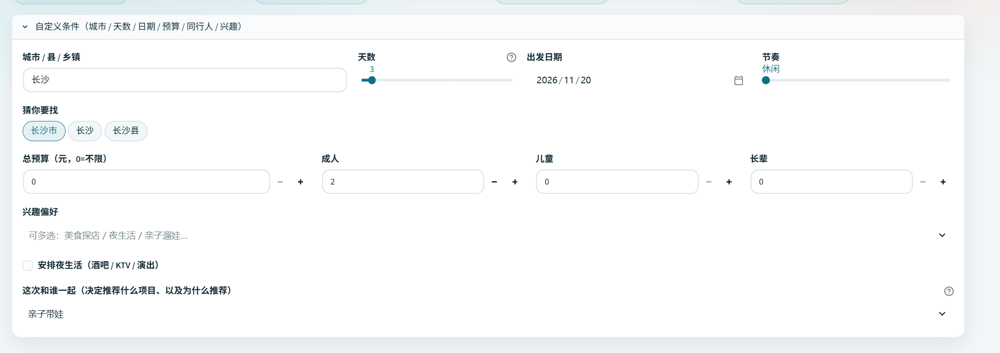
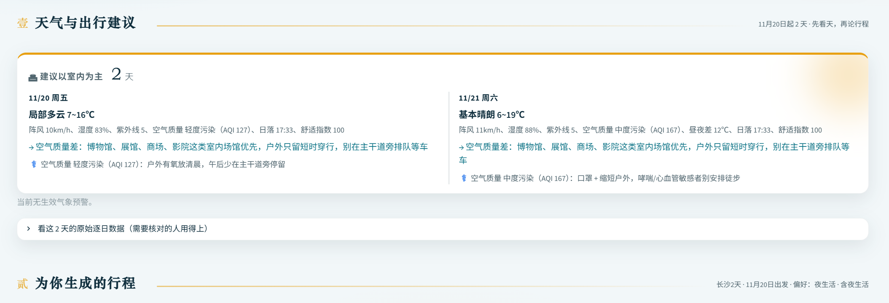
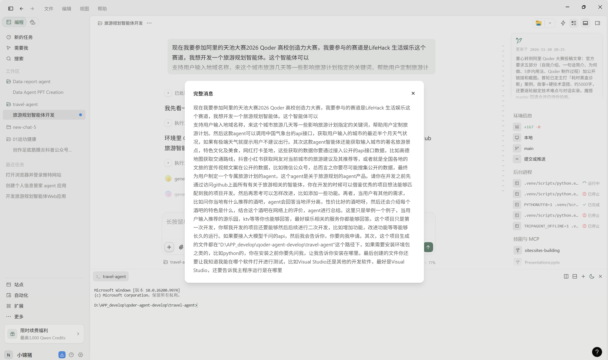
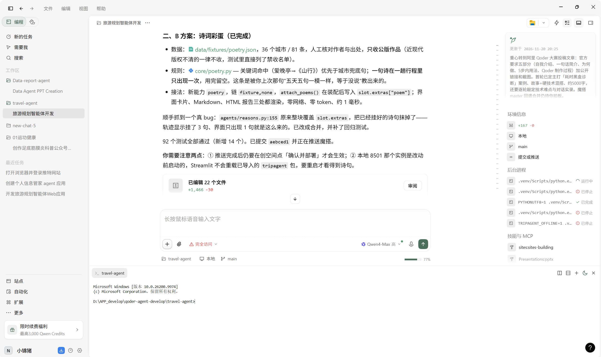
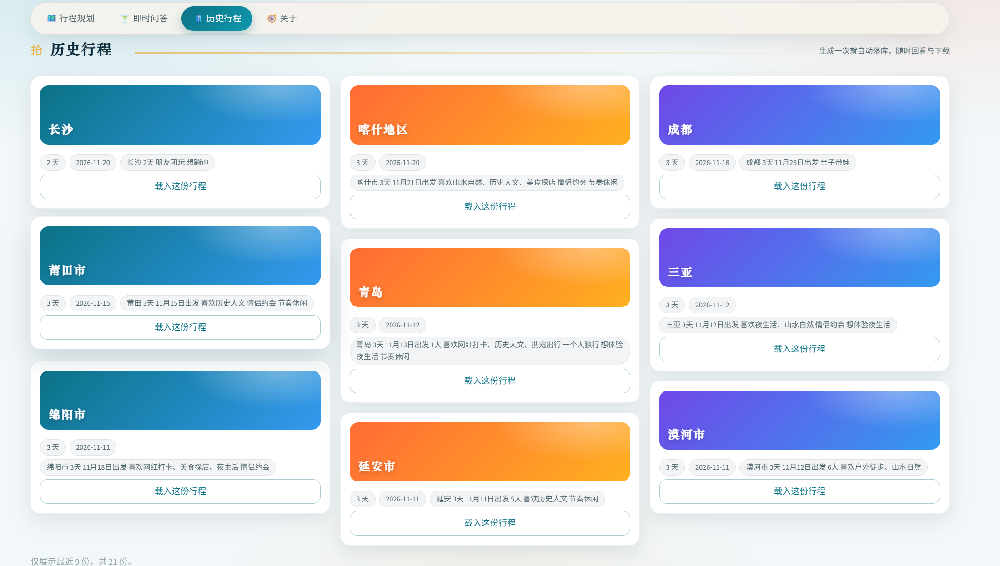
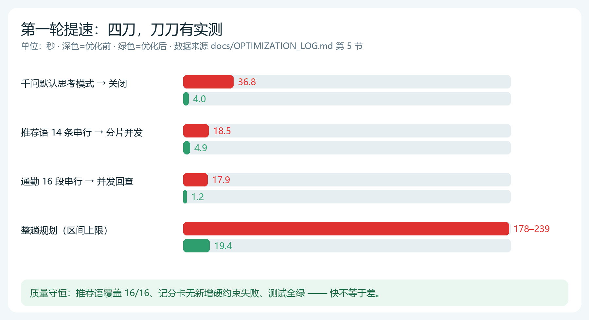
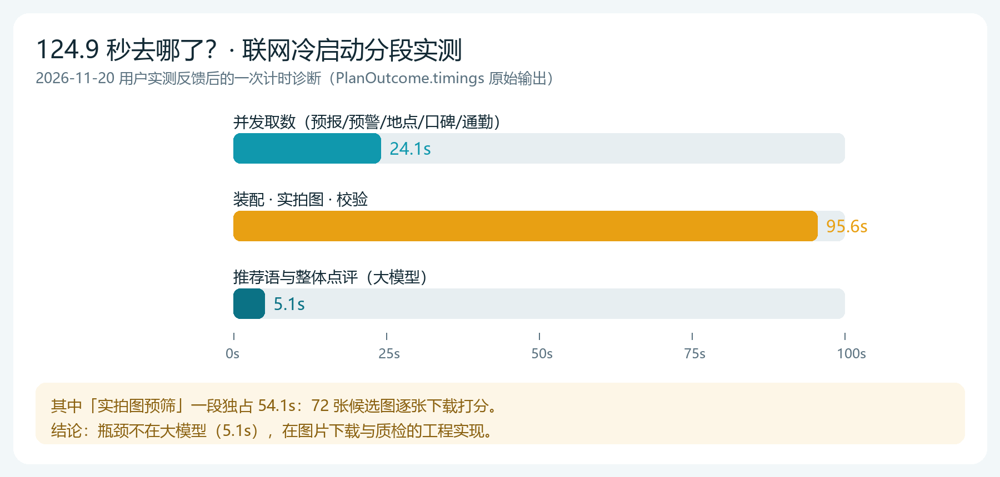
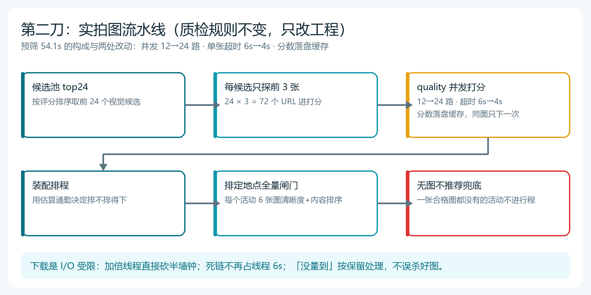

# 【LifeHack】TripAgent · 山海行旅：一个会看天气的旅行管家——每条推荐都有依据，每一项安排都逐条通过校验

> 2026 Qoder 高校创造力大赛 · LifeHack 生活娱乐赛道 · 个人参赛
> 作品链接（Qoder Sites 公开访问，点开即用）：<https://tripagent-travel-mo2hxigbsa3.qoder.zone>
> 完整应用（魔搭创空间，Running）：<https://ginpiga-travel-agent.ms.show>
> 开源仓库（Public，不含任何密钥）：<https://github.com/zdj18259632835-design/Travel>

## 一、自我介绍

我是一名在校大学生，计算机科班出身，这是我第一次从零把一个想法完整交付成"别人点开就能用"的产品。没有团队，我的搭档是 Qoder：我负责提需求、做取舍、拿着真实使用反馈一轮轮挑毛病，Qoder 负责把每一轮对话变成可运行的代码、测试和部署。这篇文章里所有的耗时数字、阈值分布和踩坑记录，都来自我们对话过程中真实跑出来的输出，而不是事后补写的宣传稿。

天池报名信息：团队名称**海底小纵队**（团队 ID **1388941**），**个人参赛**，队员 **Milan.**（即本人），已完成加入与实名认证，所用 Qoder 账号与报名信息一致。


## 二、作品是什么

**一句话：TripAgent 是一个"先看天、再论行程"的国内旅行规划智能体——你用一句话说清想去哪、和谁去、爱吃什么，它查 16 天预报和实时气象预警，把每天分成"适合户外 / 以室内为主 / 不建议出行"三堆结论，再装配出带实拍图、人均价、推荐理由和逐条校验记分卡的逐日行程。**

它和"AI 写攻略"的根本差别有三条：

1. **天气不是装饰，是决策**。极端天气直接给"不建议出行"并推荐改期窗口；可救的日子自动把户外换成室内，而不是在攻略末尾贴一句"记得带伞"。
2. **每条推荐可回溯**。评分、人均、营业时间、预约窗口来自高德/腾讯双源交叉校验；大模型只允许写"有据事实"，禁止"值得一去"这类空话（有测试强制禁止）。
3. **方案有记分卡**。环境事实、常识约束、用户硬约束三个维度共 18 项校验逐条给出通过/未通过与修复建议，参考 TravelPlanner 的约束分类——AI 的安排也要接受审计。


### 技术栈：千问管"内容规划"，高德管"事实数据"

作品的两条主动脉是**通义千问大模型（qwen3.6-flash，百炼接入）**与**高德开放平台 API**，分工明确、互不越界：

- **千问 3.6 —— 内容规划层**。负责把结构化事实改写成"人话"：联网检索归纳目的地口碑与避坑信息、按同行人/兴趣生成每条活动的推荐理由、撰写整体行程点评。它**只允许基于已有证据改写，不允许编造事实**；并且默认关闭思考模式（`enable_thinking=False`）——这类任务是抽取与改写而非多步推理，关掉后单次调用从 36.8s 降到 4.0s（详见第七节实测）。
- **高德开放平台 —— 事实数据层**。提供 POI 检索与评分、人均消费、营业时间、**实拍图**（作品里所有活动配图的唯一来源，经清晰度与内容信号质检后才展示）、以及驾车/步行**交通路线规划**（逐段通勤时长与"散场后回酒店"的夜间返程校验都靠它）。
- **气象三源**：Open-Meteo 数值预报 + 和风天气 + 中国气象局/中央气象台实时预警，构成"先看天"的证据链；腾讯位置服务作为地点数据第二源交叉校验。
- **工程底座**：Streamlit 承载完整应用界面，httpx + 线程池做并发取数与图片质检（numpy 清晰度打分、Pillow 图像处理），Qoder Sites 侧用 Deno 边缘函数实现免密钥天气速查。

一句话概括这套分工：**数据必须有出处（高德/气象/腾讯），文字必须有依据（千问只改写不编造），安排必须过校验（18 项记分卡）。**

## 三、为什么做

起因是一次真实的家庭出行翻车：攻略里排满户外景点，出发当天暴雨，全家在酒店刷手机。我复盘时发现市面上攻略类产品有三个通病——**天气是贴上去的表格、推荐是没有出处的形容词、行程是没有人校验的许愿清单**。抄一篇小红书笔记就能"生成攻略"的时代，缺的不是文字产量，而是"敢不敢对安排负责"。

所以我把作品立项成一句话：**让 AI 排的行程，先过天气关、再过证据关、最后过约束关。** 生活娱乐赛道里"旅行"是被做烂的题材，但"对安排负责"这件事几乎没人做——这就是我想切的口子。

## 四、怎么用（5 步，评委照着能自己跑通）

1. 打开 Qoder Sites 公开地址（无需登录、无需安装）。首页可直接玩"天气速查"：边缘函数免密钥直连 Open-Meteo 数值预报与中国气象局预警，输入城市即出结论。
2. 点进完整应用入口（魔搭创空间）。如提示体验口令，请在本帖留言或按天池报名页联系方式获取——口令只用于保护全站共享的模型额度，不设观看门槛。
3. 在搜索卡输入一句话，例如「长沙 2天 朋友团玩 想蹦迪」，或点一枚灵感胶囊；展开"自定义条件"可精确控制城市/天数/日期/预算/同行人/兴趣。
4. 点「开始规划」。页面底部「本次耗时分布」折叠栏会列出每一段真实秒数——我们把性能做成了可见的承诺，而不是黑箱。
5. 按顺序读结果：天气三堆结论 → 逐日时段轴（实拍图轮播、人均、推荐理由、诗词彩蛋）→ 预算与清单 → 校验记分卡。每次生成的行程都会自动存进「历史行程」页，随时一键载入回看或导出。





## 五、用 Qoder 做出来的过程

**分工原则：我拍板"做什么、不做什么、什么算好"，Qoder 落地"怎么做、怎么测、怎么部署"。** 每一轮都是"我提真实反馈 → Qoder 给方案并问我确认 → 开发 → 实测 → 我再挑毛病"的闭环，而不是一次性甩需求。几个关键轮次：

- **数据源轮**：我要求"零 Key 也能跑、断网可演示"。Qoder 为每个外部源做了本地降级链（预报/预警/地点/口碑/通勤/大模型六条链），并坚持"密钥只进 `api_keys/` 目录、由我亲手写入"——这条隐私规矩从头到尾没破过。

- **实拍图轮**：我看到候选里混着停车场白车照片，直接下令：

  > 「数据库没有图片就不要提供这个活动。」——我的原话，被 Qoder 写进了 `service.py` 的函数注释留痕

  于是有了"无图不推荐"闸门：视觉类活动一张合格公开图都没有就不进候选、排上了也兜底移除；合格图还要过清晰度与内容信号质检，每个活动最多留 6 张并按"最该看的一张"排序。

- **文案轮**：我连着两次反馈钟点表残留：

  > 「09:00-11:00 还在。」——我的原话，被写进 `tests/test_ui_smoke.py` 的测试注释，防复发

  Qoder 因此把"时段词（上午/傍晚/晚上）"做成硬测试：跑真实 app.py 检查旧钟点卡片有没有复活。同轮还有天气文案：

  > 「五天五句一模一样，等于没说。」——我的原话，留在 `weather_risk.py` 注释里

  解法不是编造差异（五天全 100 分时硬写区别是造假），而是按舒适指数在行程内部排名、让每天的建议由当天主导要素现场拼装。

- **界面轮**：我说「原来的风格太朴素了」，并要求"不断对话确认需求再开发"。Qoder 用三轮提问定下风格/幅度/头图/动效，重构成"山海行旅"主题：雪岭头图、胶囊搜索卡、时间轴行程、记分卡环图。

- **实测反馈轮（最近一次）**：我拿真实使用截图提了两条不满——耗时太长、天气面板字小右边空白。这一轮直接催生了下文第七节的第二次提速诊断和宽卡重排。

### 对话凭证：从立项原话到一轮交付的完整截图

以上过程不是事后回忆，Qoder Desktop 里留着每一轮的原始记录，这里放两张最有代表性的：

**第一张是立项那一刻。** 我在对话框里写下的原始需求（点开"完整消息"可见全文）：要参加 2026 Qoder 高校创造力大赛 LifeHack 生活娱乐赛道、开发一个旅游规划智能体——查中国气象台接口看半个月天气、极端天气提示不建议出行、接高德拿交通路线、只搜集公开数据、还要支持后续二次开发。同一条消息里我立下了贯穿整个项目的规矩：**接入千问 API 要先向我申请、装任何环境包要先问我安装位置、所有文件只落在项目目录内**。后来"密钥只进 `api_keys/`、由我亲手写入"的隐私机制，正是这条消息的延伸。



**第二张是"诗词彩蛋"轮的交付回执。** 一轮对话下来，Qoder 直接给出可验收的结果：**已编辑 22 个文件（+1,466 −30）、92 个测试全部通过（新增 14 个）、已提交 `aebced1` 并正在推送魔搭**，还主动提醒"本地实例是改动前启动的，要重启才看得到诗句"。工作区就是本仓库 `travel-agent`，右侧能看到它管理的后台进程。我提一个想法，收回来的不是代码片段，而是"改完、测完、提交完、部署完"的闭环——这就是我说"搭档是 Qoder"的具体含义。




## 六、亮点速览

- **光照敏感排期**：日落 17:33 的城市，傍晚档只排"光线最柔"的活动；正午暴晒档自动转室内或用餐，时段说明动态引用当日温度/紫外线/日落时刻。

- **生活娱乐是一等公民**：酒吧/KTV/夜店/剧场/乐园/密室有独立类目、准入门槛与"散场后回酒店"的夜间返程校验（这一段保留同步真实路径查询——安全信息不给估算值）。

- **诗词彩蛋**：本地公版联句按地点挂载（杜甫《江南逢李龟年》写在潭州船上，就挂长沙），零网络零 token。

- **历史行程自动归档**：每生成一份行程就自动落库，「历史行程」页以封面卡片陈列——城市名、天数、生成日期、当初那句原始需求一目了然，点「载入这份行程」即可完整回到当时的天气结论、逐日安排与记分卡，还能导出带走。截图里已沉淀 21 份真实规划，从长沙、成都、青岛、三亚到喀什地区、漠河市——这也侧面验证了 3648 条城市坐标表的全国覆盖不是纸面数字。

- **双部署形态**：Qoder Sites 静态站 + Deno 边缘函数承载免密钥天气速查（平台跑不了常驻 Python，就先搞清楚平台能跑什么再动手）；完整 Streamlit 应用托管魔搭创空间。

- **隐私与开源分离**：`github` 分支剥离魔搭专属文件，全历史扫描确认从未跟踪过任何密钥文件后才公开。




## 七、开发中最大的困难：耗时黑箱，与两次"先测量再开刀"

这是我最想讲的一段，因为它完整体现了"我和 Qoder 如何合作解决一个真问题"：**不猜瓶颈，先让时间可见；每一刀都要有实测数字；快不能以质量为代价。**

### 第一幕：一次规划要等 178–239 秒

第一版能跑通但慢得没法演示。Qoder 的第一件事不是优化，而是加分段计时（`PlanOutcome.timings` + `scripts/time_plan.py`），把一次规划拆成"并发取数 → 选住宿 → 装配 → 实拍图 → 校验 → 推荐语/点评"。拆出来最大一段是 `·推荐语 60.2s`——于是写探针量纯文本调用，真相出乎意料：

| 参数                      | 耗时        | completion tokens | 内部推理长度  |
| ----------------------- | --------- | ----------------- | ------- |
| 千问默认（思考模式开）             | **36.8s** | 5040              | 11260 字 |
| `enable_thinking=False` | **4.0s**  | 358               | 0       |

模型在回答前先写了一万一千字内部推理，而正文只有 358 token。推荐语/点评/口碑归纳是"抽取与改写"，不是多步推理——**这些 token 我们既看不见也不需要**。关掉思考单这一项 147.7s → 38.5s；联网检索同理 51.2s → 7.9s。

### 第二幕：并发化与三个隐性坑

剩下串行段逐个并发化，过程中踩的坑比优化本身更值得记：

- **`as_completed` 固化集合**：住宿口碑任务需要"候选一回来就中途追加"，而 `as_completed` 在调用时就把可迭代对象固化，后加的 future 永远不被观察。改用 `wait(FIRST_COMPLETED)` 循环自维护 pending 集合。
- **输出长度就是延迟**：推荐语一次写 14 条要 18.5s；改每片 6 条、3 片并发后 4.9s，条数一条没少。
- **全角竖线协议 bug**：并发后推荐语命中率反而只有 6/16——样例里的全角「｜」被模型照抄，解析器只认半角 `|`。统一半角后 16/16。

通勤 16 段串行 HTTP 改"装配用估算 + 完成后 6 路并发回查真实路径"，17.9s → 1.2s。第一轮合计 **178–239s → 19.4s**，且质量守恒：推荐语覆盖 16/16、记分卡无新增硬约束失败、测试全绿。



### 第三幕：用户实测打脸——冷启动 124.9 秒，瓶颈不在模型

我以为性能故事讲完了。直到我拿着真实使用反馈回来：

> 「我进行了一次测试，发现以下一些功能的不满意，第一为什么这次回答耗时那么长。」——我的原话（2026-11-20 实测反馈）

19.4s 是缓存命中后的数字；评委和游客第一次打开是**冷启动**。Qoder 跑了一次联网计时诊断，原始输出：

```
WALL 124.9
TIMINGS {"并发取数": 24.1, "选住宿": 0.0, "·装配": 59.5, "·校验": 0.0,
         "装配·实拍图·校验": 95.6, "·整体点评": 4.6, "·推荐语": 5.1,
         "推荐语与点评": 5.1, "总计": 124.9}
PHOTO_MS 54075
```



结论反直觉：**大模型只占 5.1s，95.6s 花在实拍图下载与质检**——预筛一段独占 54.1s（24 个候选 × 探 3 张 = 72 张图逐张下载打分）。第一幕砍的是模型，第三幕要砍的是工程：

- **并发 12 → 24 路**：下载是 I/O 受限而非 CPU 受限，加倍线程直接砍半墙钟；
- **单张超时 6s → 4s**：死链以前占住打分线程整整 6 秒，是长尾主因；而"没量到"在两道闸门里都按保留处理，收超时只减少测量、不会误杀好图；
- **分数落盘缓存**：同一张图全站只下一次，第二次规划直接命中。



同时把分段耗时做成界面底部可见的折叠栏——**性能从"开发者日志"变成"对用户的公开承诺"**。质检规则（无图不推荐、每活动 6 张、清晰度硬阈值）一条没动：快，不能以删掉好图或放进糊图为代价。

### 这一段留给评委的方法论

三轮优化共用一条纪律：**先度量、再假设、后开刀，每刀复测质量**。思考模式藏在 `completion_tokens` 里、`as_completed` 藏在 API 语义里、冷启动藏在缓存命中率里——三个瓶颈没有一个是靠"感觉慢"猜出来的。

## 八、实测数据与质量底线

| 项目     | 实测值                                            |
| ------ | ---------------------------------------------- |
| 回归测试   | 118 项全绿（含真实跑 app.py 的界面冒烟测试）                   |
| 第一轮提速  | 178–239s → 19.4s（缓存命中）                         |
| 冷启动诊断  | 124.9s = 取数 24.1 + 装配·实拍图·校验 95.6 + 推荐语与点评 5.1 |
| 思考模式探针 | 36.8s / 5040 tokens → 4.0s / 358 tokens        |
| 约束校验   | 18 项记分卡（环境事实/常识约束/用户硬约束）                       |
| 城市覆盖   | 内建 3648 条城市坐标表（含县城/乡镇），中文直输不拼拼音                |
| 部署状态   | Qoder Sites 公开 HTTP 200（发帖当日实测）；魔搭创空间 Running  |

### 持续完善台账：500 次实测、21 次部署更新、测试从 42 长到 118

这份作品不是"一次生成"的：按我自己的计数，累计跑了 **500 次实测**（本地真实规划 + 以访客身份体验魔搭创空间）。几乎每一轮不满都变成了下一轮的需求——停车场白车图、画幅失控、字号偏小、诗词覆盖不足、耗时太长、天气面板右边空白——都是我先实测发现、Qoder 修复、我再实测复核的闭环。完善轨迹可以在 git 历史里逐条对证：

| 完善维度     | 数据轨迹                                        | 对证方式                  |
| -------- | ------------------------------------------- | --------------------- |
| 人工实测次数   | 累计 500 次（我的计数）                               | 体验与反馈记录               |
| 回归测试     | 42 → 54 → 92 → 118 项，每轮全绿                     | 各提交点测试函数计数（54/92/118 已逐一复核） |
| 交付提交     | main 分支 21 个提交，每个对应一轮"反馈 → 开发 → 实测"           | `git rev-list --count main` |
| 魔搭部署更新   | 21 次推送更新，每次都需要在创空间手动点「确认并部署」才生效             | deploy 分支交付提交链         |
| 实测驱动的修复  | 如 `e691c31`（实测四问题）、`ce2a674`（耗时与天气面板）        | 提交信息即反馈原话的落地          |

测试从 42 长到 118，长的不是数量而是"防复发"：旧钟点卡片复活检查、空话禁令、CSS 选择器存在性验证……**我挑过的每一个毛病，最终都变成了一条不会再退化的测试**。21 次部署更新同样不是演示截图：创空间是一个被推送过、被平台内容审核回退过、又经合并重推恢复、至今仍在 Running 的活空间——连那次回退都是这条完善链上的一环。

## 九、不足与展望

诚实列出当前边界：第二刀提速后的冷启动总耗时**尚未复测**（联网诊断消耗共享模型额度，我不愿意为写文章刷额度），预期显著下降但数字以复测为准；图片缓存冷/热差异仍大，首次打开偏慢；行程目前单城市，跨城联程与真实用户小范围测试是下一步。我认为把边界写清楚，比把作品说满更接近"对安排负责"的立项初衷。

## 十、原创与合规声明

本作品为大赛期间原创，开发与部署全程使用 Qoder（所用 Qoder 账号与天池报名信息一致）。实拍图来自高德开放平台已授权接口返回的公开商户/景点图，未抓取小红书/抖音等第三方社区内容；诗词彩蛋仅使用公版古诗联句；气象数据来自 Open-Meteo、中国气象局/中央气象台公开接口。仓库经全历史扫描确认从未包含任何 API Key、口令或凭据文件；密钥仅存于本地 `api_keys/` 目录与平台密文变量。

---

*如果这份作品让你想起某次被暴雨毁掉的旅行——欢迎点开链接，输入一句话，看看"先看天、再论行程"是什么体验。评委老师如需体验口令或复现任何一张配图里的数字，本帖留言即可，所有计时脚本与测试都在开源仓库里。*
